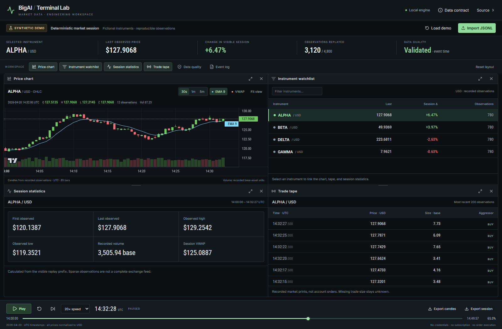

# BigAl Terminal Lab

[](https://github.com/lamarcaale754-blip/bigal-terminal-lab/actions/workflows/verify.yml)
[](LICENSE)

An interactive market-data replay terminal built with **React, TypeScript, and TradingView Lightweight Charts**. It turns timestamped observations into inspectable candlesticks, a linked trade tape, and session statistics—without inventing missing measurements.

**[Open the live demo](https://lamarcaale754-blip.github.io/bigal-terminal-lab/)** · [Data contract](docs/DATA_CONTRACT.md) · [Architecture](docs/ARCHITECTURE.md) · [Design decisions](docs/DECISIONS.md)



## Run it

Requires **Node.js 22.12+** (Node 24 is used in CI).

```bash
npm ci
npm run dev
```

Open the local URL printed by Vite. The application starts with **4,800 deterministic synthetic observations** across four fictional instruments. Press **Play**, change replay speed, drag the timeline, or step to the next event time. No account, API key, wallet, backend, or gRPC subscription is needed.

```bash
# Production build and local preview
npm run build
npm run preview

# Optional container: builds the same static application
docker build -t bigal-terminal-lab .
docker run --rm -p 8080:8080 bigal-terminal-lab
```

The container serves at `http://localhost:8080` as a non-root Nginx process. This is a static app; opening `dist/index.html` directly through `file://` is not supported. Use a web server so modules and the import worker load correctly.

## What it demonstrates

| Capability                            | Implementation                                                                                                                      |
| ------------------------------------- | ----------------------------------------------------------------------------------------------------------------------------------- |
| Honest chart aggregation              | Event-time OHLC in half-open UTC buckets; no fabricated wicks, gap filling, or price/percentage substitution                        |
| Indicators with explicit requirements | Causal EMA9; actual size-weighted session VWAP and recorded volume, hidden when quantities are incomplete                           |
| Reproducible replay                   | Monotonic playback clock, speed control, step, pause, and deterministic prefix reconstruction on seek                               |
| Bounded ingestion                     | Web Worker JSONL validation; 5 MiB / 20,000-record limits; ID deduplication and conflict reporting                                  |
| Linked workspace                      | Instrument selection drives the chart, tape, and statistics; resizable/maximizable panels; keyboard controls; saved panel selection |
| Inspectable data                      | Quality panel, event log, normalized JSONL export, and CSV export of only the currently revealed candles                            |
| Deployable frontend                   | Strict TypeScript, unit and browser tests, CI, static GitHub Pages deployment, and a container smoke test                           |

The workspace was adapted from my newer local terminal interface. The data engine and chart calculations were rebuilt for this standalone edition. See [provenance](docs/PROVENANCE.md).

## Replay your own recording

Choose **Import JSONL**. Each line is a normalized observation:

```json
{"id":"obs-001","ts":1776693600000,"symbol":"ALPHA","price":120.5,"size":2.4,"side":"buy"}
{"id":"obs-002","ts":1776693602500,"symbol":"ALPHA","price":120.8,"size":1.1,"side":"sell"}
```

- `ts` is UTC epoch milliseconds; `price` is normalized to USD; optional `size` is executed base-asset quantity.
- Omit `size` or `side` if your recording does not contain them. The application does not infer either field.
- Files are processed locally in a browser worker. There is no upload, telemetry collection, or connection to a trading service.
- Accepted observations are sorted by timestamp. Equal timestamps retain input order. Invalid rows and conflicting duplicate IDs are reported in **Data quality**.
- Importing replaces the current in-memory session and starts paused at the first event. A wholly invalid or oversized file leaves the existing session intact.
- Refreshing restores the demo; only the list of open panels is saved. Use **Export session** to save normalized data before refreshing.

Try [example-session.jsonl](public/example-session.jsonl), including sparse intervals and a price-only instrument. Exact bounds, deduplication semantics, and indicator definitions are documented in the [data contract](docs/DATA_CONTRACT.md).

## Verify it

```bash
npm run check             # ESLint, data-engine tests, TypeScript, production build
npm run test:coverage     # Coverage for the pure data engine (not the entire UI)
npx playwright install chromium
npm run test:e2e          # Production-preview browser scenarios
```

The browser suite exercises replay and symbol linking, malformed/duplicate imports, missing volume, file downloads, panel persistence, keyboard resizing, and a narrow viewport. It also checks for unexpected external requests and browser errors. To use an installed Edge browser, set `PLAYWRIGHT_CHANNEL=msedge` in your shell before running the browser suite.

CI runs the checks and browser suite, builds and smoke-tests the container, and publishes the verified static build to GitHub Pages. The synthetic feed makes these tests repeatable without paid market-data access.

## Boundaries and tradeoffs

- This is a **market-data inspection and replay application**, not an order router or account dashboard. It does not execute trades or calculate account PnL.
- Demo observations are explicitly fictional. Imported files are not independently authenticated as exchange data.
- Candles summarize **recorded observations**, which can be sparse. They are not guaranteed complete-market OHLC or volume. Empty intervals remain gaps.
- Session VWAP begins at the first visible observation; EMA is seeded at the first observed close. The latest bar is partial at the replay cursor.
- Numeric calculations use JavaScript floating point, suitable for visualization rather than financial settlement.
- Live gRPC/provider connectivity has **not** been tested and is not bundled. A provider adapter can normalize an existing recording into the documented file contract without changing the viewer.
- The bounded file model favors reproducibility and simple deployment. It is not an unbounded exchange-feed collector. Chart aggregation scans the visible session; very large streams belong in a separate ingestion service.

The complete private application remains separate. This repository starts with fresh history and contains only the standalone viewer, synthetic fixtures, documentation, and verification tooling.

## License

[MIT](LICENSE) for application source. Fonts are openly licensed Inter and Roboto Condensed, bundled locally. TradingView attribution is retained. See [third-party notices](THIRD_PARTY_NOTICES.md).
