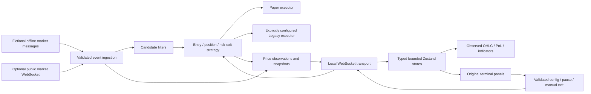

# Architecture

## Modules

- `bot/bigalbot_customizable.py` retains the original candidate, position, entry and risk-exit logic. A small local service surrounds it with bounded market ingestion, configuration validation, WebSocket snapshots, and static dashboard hosting.
- `bot/executor.py` defines the source Paper/Legacy interface. Paper execution is the default. Legacy dependencies and wallet initialization occur only for explicitly configured live execution. Confirmation failure is handled separately from a successfully submitted order.
- `bot/strategy_mode.py` and `bot/passive_features.py` retain parameter resolution, dynamic hold and volume-exit signals. Unfinished/private intelligence dependencies are omitted.
- `bot/offline_feed.py` generates fictional create/buy/sell inputs. It feeds the same strategy functions used for public-feed events; trade outcomes are not precomputed fixtures.
- `src/terminal/components` contains the newer terminal's actual layout, menus and panels. A panel registry controls available tools, and error boundaries isolate panel failures. Chart components release their series, resize observers and chart instances on unmount.
- `src/terminal/lib/protocol.ts` normalizes remote frames before they enter state. Partial stats do not erase separately delivered candidates or positions. A partial exit event does not prematurely remove its position.
- `src/terminal/hooks/useWebSocket.ts` owns an explicitly initiated connection and bounded reconnect attempts. Commands sent while disconnected are rejected locally, never queued for replay. Connection generations prevent stale socket callbacks from mutating a new session.
- `src/terminal/stores` separates configuration from high-frequency state. Charts retain at most 10,000 observations; trade history 2,000 records; logs 300 entries; candidates 500 rows; toasts 8 items.
- `src/core/candles.ts` and `src/terminal/lib/chartData.ts` implement pure chart transforms. The core folder also includes independently tested JSONL normalization and synthetic fixture utilities; a file-import workflow is not part of the restored terminal UI.
- `src/terminal/lib/preview.ts` supplies the static hosted UI fixture. It does not run the Python strategy or claim to simulate exchange execution. A persistent Preview label distinguishes it from the local paper backend.

## Runtime boundaries

The Python service defaults to loopback HTTP and WebSocket listeners. WebSocket Origin validation admits the local dashboard and development origins, rather than arbitrary websites. The optional container bind address is allowed only in offline mode; Compose publishes its ports on host loopback.

The dashboard neither stores nor requests wallet credentials. The static public site has no provider integration and opens no backend connection on page load. A local backend is required for actual strategy control. The service is intended for a single user's local machine, not an Internet-facing multi-tenant deployment.

Custom presets and the trade journal live in ignored `.runtime/`. UI state is otherwise in memory; reconnect snapshots recover the running process's recent data. This is not a durable order-management database. Process crashes, live reconciliation and production deployment require further engineering.

## Computation and verification

Each selected chart filters and sorts the bounded observation window, then aggregates in event order. This is `O(n log n)` per rebuild and favors transparent correctness over incremental cache complexity. Source tables use virtualization where appropriate. There is no throughput claim or synthetic latency benchmark.

Validation spans exact numerical unit cases, typed protocol normalization, browser interactions on a production build, extracted strategy tests, mocked failure paths, real loopback transport tests, and container smoke tests. No check makes a live trade or proves market profitability.
