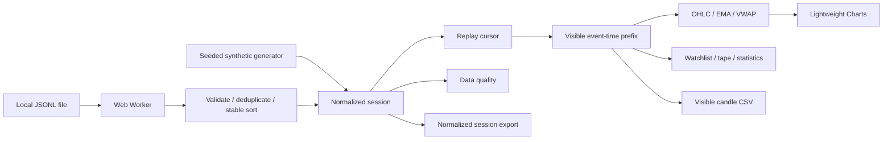

# Architecture

## Source boundaries

- `src/core/` contains pure functions: parsing, validation, sorting, deduplication, aggregation, indicators, and reproducible fixture generation. It has no React or browser dependencies other than standard platform primitives such as `TextEncoder`.
- `src/import.worker.ts` performs import work away from the rendering thread. Messages carry only parser results. A completed valid import atomically replaces the session; a worker/read error retains the old one.
- `src/hooks/useReplay.ts` owns the replay clock, with a monotonic wall-clock delta and a 100 ms rendering cadence. A binary search locates the inclusive event-time prefix. Seeking pauses first. A queued timer callback cannot advance a paused frame.
- `src/components/MarketChart.tsx` owns the imperative chart instance and series. React supplies data and display controls. The adapter releases the chart, crosshair subscription, and ResizeObserver on unmount. Symbol/timeframe changes fit the viewport; ordinary ticks preserve user zoom.
- `src/components/Workspace.tsx` owns panel layout and accessible resizing. Registry-driven panel selection avoids controls pointing to nonexistent modules. Each panel is isolated by an error boundary.
- `src/components/DataPanels.tsx` presents linked observations and diagnostics. `src/lib.ts` provides formatting, stable summary statistics, and browser-only downloads.
- `src/App.tsx` owns session replacement, selected instrument, and the panel registry. It persists only panel choices under a versioned local-storage key. Session contents remain in memory.

## Complexity and resource bounds

Parsing and deduplication are linear in record count, followed by a stable `O(n log n)` timestamp sort. Prefix lookup is `O(log n)` and prefix materialization is `O(n)`. Chart aggregation filters/sorts the selected prefix, and series are updated at the UI cadence. This favors auditable behavior over a complex incremental cache at a maximum of 20,000 records. The tape renders at most 200 rows; the activity log retains at most 200 entries; only the first 100 validation issues are rendered at once.

For much larger streams, use a separately bounded ingestion process and incremental aggregation. This project does not claim exchange-scale throughput or use simulated latency numbers as measurements.

## Trust and network model

The static host delivers application code, fonts, and examples. Data parsing, replay, charts, and export run in the browser. There is no WebSocket client, provider SDK, subscription credential, transaction signer, order endpoint, analytics tracker, or data upload. Source and chart attribution links are ordinary user-initiated navigation.

The public export was assembled from an explicit presentation-file allowlist into a fresh directory. It does not inherit private Git history, archives, configuration, account data, or execution modules. Public fixtures are generated or handcrafted from fictional data.

## Verification layers

1. Unit tests assert exact numerical/validation behavior, including rejection boundaries, duplicate conflicts, sparse buckets, incomplete size data, causal prefixes, and deterministic fixtures.
2. Strict TypeScript and ESLint check component and worker contracts.
3. Browser tests drive the production build, real worker, canvas chart, file input/downloads, replay controls, and accessible workspace controls.
4. CI builds a non-root static container and requests its page/example file before deploying the same static build to GitHub Pages.

These checks require no gRPC subscription and make no claim about a live provider or the private application's runtime.
